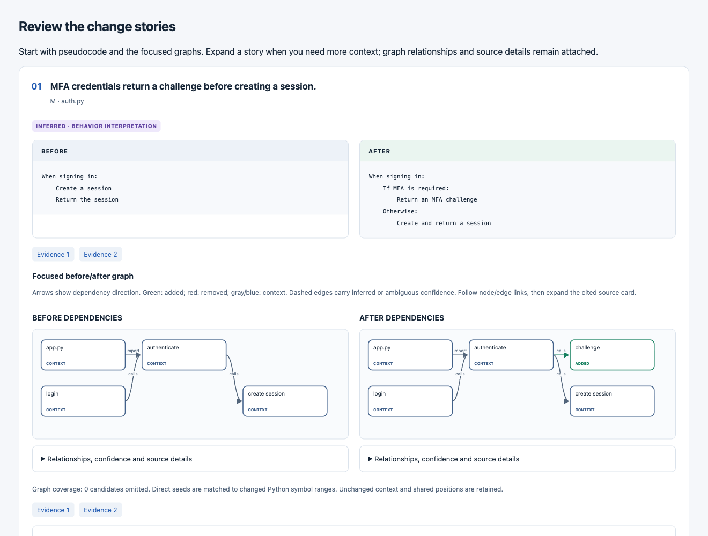

# Graphify Review

Human-readable code reviews built on [Graphify](https://github.com/Graphify-Labs/graphify): **before/after graphs, behavioral pseudocode, blast radius, and exact source evidence**.

Start with the change stories. Expand a focused graph or pseudocode explanation, inspect potential dependents, then follow a citation to the committed source. Each layer reveals details when the reviewer needs them.

Example: real extracted graphs with **mocked, authored pseudocode** (also labeled in the generated review).



Graphify supplies extraction, graph comparison, dependency traversal, and optional model providers. This independent package owns the review model, human presentation, source evidence, and its own CLI. It installs against the ordinary PyPI distribution; no Graphify patch or unmerged PR is required.

## Install and run

Python 3.10+ and Git are required. Install directly from this repository:

```bash
uv tool install git+https://github.com/mikkelkrogsholm/graphify-review.git
cd /path/to/the/project/being/reviewed
graphify-review --base main --head feature
```

For a GitHub PR, authenticate `gh` and run inside a checkout of its repository:

```bash
graphify-review 42
graphify-review 42 --repo owner/repository
```

The command prints the paths to portable `review.html` and `review.json` files under `graphify-review-out/reviews/`. Open the HTML in a browser. Required graphs, styling, disclosure controls, and source excerpts work offline.

Use `--output /path/to/reviews` or set `GRAPHIFY_REVIEW_OUT` to choose the output root. Add `graphify-review-out/` to the reviewed project's `.gitignore` if keeping artifacts locally.

## Behavioral pseudocode

The deterministic default builds source-backed graphs and impact without discovering or calling a model. Behavioral pseudocode uses an explicit inference request:

```bash
uv tool install 'graphify-review[llm] @ git+https://github.com/mikkelkrogsholm/graphify-review.git'
graphify-review 42 --infer --backend ollama --model <configured-model>
```

Provider configuration follows Graphify. The `llm` extra installs its OpenAI-compatible SDK support, including Ollama. An explanation written by another tool is accepted the same way with `--narration` and is validated identically. Explanations always remain **INFERRED**, cite supplied base/head evidence, and expose uncertainties. Citation validation checks provenance, not semantic correctness. Missing providers or rejected responses leave the structural review usable with an explicit status.

## Using it from another tool

Two refs are enough: no network, no forge client, and a read-only checkout works. Add `--facts` and `--evidence` for the analysis as data, `--narration` for an explanation written elsewhere, `--checks` for verdicts, and `--comment` with `--view-url` for a short markdown comment (about 3 KB) that links to the page. See [integration](docs/INTEGRATION.md) for the command lines and file formats.

## What the reviewer gets

- A structural risk level with reasons, an ordered "look at these first" list, and tests that reach each changed symbol (or none).
- Verdicts of checks, tester and reviewer when supplied.
- Change stories and before/after behavioral pseudocode.
- Bounded directed SVG graphs with consistent positions, confidence labels, and added/removed relationships.
- Potential blast radius, unchanged dependents, and snapshot-local communities.
- Exact fixed-revision source excerpts, source diffs, and visible coverage gaps.
- Native expandable details and text equivalents for graph relationships.

See [architecture](docs/ARCHITECTURE.md) and [boundaries](docs/BOUNDARIES.md) for the Graphify integration and the review's practical limits.

The [generated example](examples/review.html) demonstrates the review. Its graphs and impact come from a real committed test repository; its pseudocode uses an explicitly mocked, authored response and is visibly labeled. Rebuild it with `uv run python -m examples.generate`.

## Development

```bash
uv sync --frozen
uv run --frozen pytest
uv run --frozen ruff check .
uv run --frozen pyright
uv build
```

The first release pins `graphifyy==0.9.92`. Some corpus/provider helpers are version-specific; the adapter checks the installed version rather than silently changing review semantics. The package is independently versioned. Dependency updates can be tested and released here without changes to Graphify.

Adapted from [the author's human-review contribution](https://github.com/Graphify-Labs/graphify/pull/3958), preserving its provenance and adversarial regression tests. Licensed under Apache-2.0; see [NOTICE](NOTICE).
