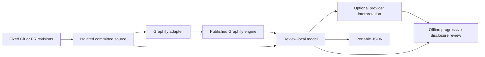

# Architecture

`graphify-review` is a separately installable command. It uses Graphify as a library dependency and does not extend its dispatcher or install files into its namespace.

| Module | Responsibility |
|---|---|
| `cli.py` | Validate arguments, choose a pinned target, and report output paths |
| `graphify_adapter.py` | The sole Graphify import boundary and tested version contract |
| `review_source.py` | Bounded committed-blob collection and physical-line evidence |
| `review.py` | Change stories, symbol mapping, potential impact, optional interpretation, and safe output staging |
| `review_html.py` | Offline directed SVG, source navigation, and progressive disclosure |

Graphify owns extraction, IDs, graph construction/diff, dependency relations, clustering, corpus filtering, and provider dispatch. We preserve those semantics by calling the installed package. Corpus filters and provider wrappers include private helpers, so compatibility is deliberately pinned and regression-tested rather than presented as a stable public SDK.

Each comparison creates equivalent temporary base/head roots and private extraction caches. Inferred explanations never enter Graphify's graph/cache. Final artifacts use the companion's own output directory. A reviewer can inspect source even when topology is unchanged or inference fails.

The review process treats repository text, model output, and PR descriptions as untrusted evidence. Reviewed code is never executed. HTML uses escaped content and a restrictive content security policy, with native disclosure controls and no scripts/CDNs.

The existing upstream PR remains a separate contribution. This companion can ship and accept changes independently; it does not require that PR to merge.
